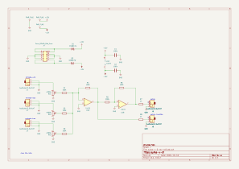

# suma

## Revisiones

- `v0.1 rev-a`: única revisión presente en el repositorio.

## Esquemático y placa (v0.1 rev-a)

Generados automáticamente por GitHub Actions a partir de `hardware/suma-v-0-rev-a/suma-v-0-rev-a.kicad_sch` y `.kicad_pcb` en cada push que los modifica.

## Bill of materials (v0.1 rev-a)

Generado a partir de `hardware/suma-v-0-rev-a/suma-v-0-rev-a.kicad_sch`.

<!-- BOM_TABLE_START -->

| Referencias | Cantidad | Valor | Huella | Descripción |
| --- | --- | --- | --- | --- |
| C1, C2 | 2 | 100n | suma-v-0-rev-a:C0805 | Condensador cerámico 0805 |
| D1, D2 | 2 | 1N5817W | suma-v-0-rev-a:SOD-123FL_L2.8-W1.8-LS3.7-R-RD | Diodo Schottky 1N5817W, protección contra polaridad inversa |
| J1, J2, J3, J5, J6 | 5 | AudioJack2_SwitchT | suma-v-0-rev-a:Jack_3.5mm_QingPu_WQP-PJ398SM_Vertical | Jack mono 3.5 mm, QingPu WQP-PJ398SM (tipo Thonkiconn), vertical, THT |
| J4 | 1 | Conn_02x05_Odd_Even | suma-v-0-rev-a:IDC-Header_2x05_P2.54mm_Vertical | Header de alimentación Eurorack (10 pines): 2x05, 2.54 mm, vertical, THT |
| R1, R2, R3, R4, R5, R6 | 6 | 100k | suma-v-0-rev-a:R0805 | Resistencia 0805 |
| R7, R8 | 2 | 1k | suma-v-0-rev-a:R0805 | Resistencia 0805 |
| RV1, RV2, RV3 | 3 | A100k | suma-v-0-rev-a:POT_TH_Alps_RK09K_Single_Vertical | Potenciómetro 9 mm, Alps RK09K, vertical, THT |
| U1 | 1 | TL072 | suma-v-0-rev-a:SOIC-8_L4.9-W3.9-P1.27-LS6.0-BL | Amplificador operacional dual TL072, SOIC-8 |

22 componentes en total.

<!-- BOM_TABLE_END -->

## Créditos

- Aarón Montoya-Moraga: investigación, esquemático, PCB, fabricación y documentación.

## Licencia

El hardware está bajo CERN-OHL-P-2.0 y esta documentación bajo CC-BY-SA-4.0. Ver [LICENSE.md](https://github.com/piruetasxyz/suma/blob/main/LICENSE.md).
